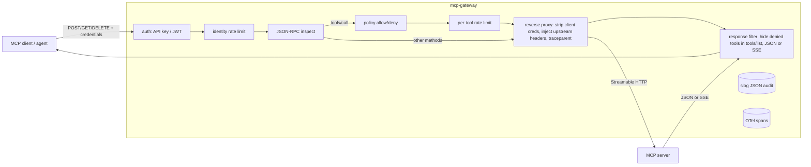

# mcp-gateway

[](https://github.com/neerajsinghi/mcp-gateway/actions/workflows/ci.yml)
[](https://pkg.go.dev/github.com/neerajsinghi/mcp-gateway)

**A small, auditable security gateway for Model Context Protocol (MCP) servers: authentication, per-identity tool policies, rate limits and audit logs in one Go binary.**

## Why

MCP servers expose powerful tools (shell, file system, issue trackers, databases) to AI agents. Most servers ship with no authentication, or with one shared token that grants every tool to every caller. Bolting auth and policy into each server is repetitive and easy to get wrong.

`mcp-gateway` sits in front of any MCP server that speaks the **Streamable HTTP** transport and enforces the same rules for all of them:

- *who* is calling (API key or JWT),
- *which tools* that identity may see and call,
- *how often* it may call them,
- and leaves a structured audit trail of every decision.

## Features

- **Reverse proxy for MCP Streamable HTTP**: JSON-RPC 2.0 over `POST`, with `application/json` and `text/event-stream` (SSE) responses streamed through without buffering. `GET` (server stream) and `DELETE` (session end) pass through after auth. `Mcp-Session-Id` and other headers are preserved.
- **JSON-RPC aware**: parses each request (single or batch) to find the method (`tools/call`, `tools/list`, ...) and the tool name.
- **Authentication**
  - Static API keys via `X-API-Key` or `Authorization: Bearer`, stored as env vars or SHA-256 digests and compared in constant time.
  - JWT bearer tokens signed with **HS256** or **RS256** ([golang-jwt/jwt/v5](https://github.com/golang-jwt/jwt)). Algorithm pinning (no `none`, no HS/RS confusion), `exp` required, optional `iss`/`aud` checks and clock-skew leeway.
- **Policy**: per-identity allow/deny lists using glob patterns. Deny wins; anything not allowed is denied.
  - Denied `tools/call` gets a JSON-RPC error (`-32003`) that echoes the request id. The upstream never sees it.
  - `tools/list` responses are rewritten so denied tools are **hidden**, in both JSON and SSE responses.
  - Identities without a binding fall back to `default_policy`, or are denied everything.
- **Rate limiting**: in-memory token buckets per identity and per identity+tool, returning HTTP `429`, `Retry-After` and JSON-RPC error `-32029`.
- **Audit log**: one `slog` JSON record per request with identity, auth method, method, tool, decision, reason, HTTP status, upstream status, hidden-tool count and latency. Secrets are never logged.
- **Credential isolation**: client `Authorization`, `X-API-Key` and `Cookie` headers are stripped before forwarding. Per-upstream headers (e.g. the upstream's own token from `${ENV}`) are injected instead.
- **OpenTelemetry tracing** (optional, off by default): OTLP/HTTP export with W3C trace-context propagation to upstreams.
- **Operations**: `/healthz`, graceful shutdown, strict config validation (unknown YAML keys are rejected), distroless container image.

## 30-second quickstart

```bash
go install github.com/neerajsinghi/mcp-gateway/cmd/mcp-gateway@latest

# Point examples/mcp-gateway.yaml at your MCP server (upstreams[].url), then:
export CI_BOT_API_KEY=change-me
export MCP_GATEWAY_JWT_SECRET=$(openssl rand -hex 32)
mcp-gateway -config examples/mcp-gateway.yaml

# In another shell:
curl -s localhost:8080/healthz
curl -s localhost:8080/mcp/github \
  -H 'Authorization: Bearer change-me' \
  -H 'Content-Type: application/json' \
  -H 'Accept: application/json, text/event-stream' \
  -d '{"jsonrpc":"2.0","id":1,"method":"tools/list"}'
```

Point your MCP client at `http://localhost:8080/mcp/github` instead of the server itself and give it the API key or JWT.

With Docker:

```bash
docker build -t mcp-gateway .
docker run --rm -p 8080:8080 \
  -v $PWD/my-config.yaml:/etc/mcp-gateway/mcp-gateway.yaml:ro \
  -e CI_BOT_API_KEY -e MCP_GATEWAY_JWT_SECRET mcp-gateway
```

## Configuration

See [`examples/mcp-gateway.yaml`](examples/mcp-gateway.yaml) for every option. A minimal config:

```yaml
listen: ":8080"

upstreams:
  - name: github
    url: http://localhost:9000/mcp     # upstream MCP endpoint
    path: /mcp/github                  # gateway path (default /mcp/<name>)
    headers:
      Authorization: "Bearer ${GITHUB_MCP_TOKEN}"

auth:
  api_keys:
    - identity: ci-bot
      key_env: CI_BOT_API_KEY          # or key_sha256: <hex digest>
  jwt:
    issuer: https://auth.example.com/
    audience: mcp-gateway
    hs256_secret_env: MCP_GATEWAY_JWT_SECRET
    # rs256_public_key_file: /etc/mcp-gateway/jwt.pub.pem

policies:
  readonly:
    allow_tools: ["search_*", "get_*"]
    deny_tools: ["*secret*"]
    rate_limit: {rps: 5, burst: 20}
    tool_rate_limits:
      search_*: {rps: 0.5, burst: 5}

bindings:
  ci-bot: readonly                     # identity -> policy (JWT identity = "sub" claim)

default_policy: ""                     # empty = unbound identities get no tools
```

Notes:

- Tool patterns use Go's [`path.Match`](https://pkg.go.dev/path#Match) syntax (`*`, `?`, `[a-z]`).
- When several `tool_rate_limits` patterns match, the lexically first pattern is used.
- To store an API key as a digest: `MY_KEY=... mcp-gateway -hash-key MY_KEY`.
- `mcp-gateway -config file.yaml -validate` checks a config without starting the server.

### Error mapping

| Situation                 | HTTP | JSON-RPC code |
|---------------------------|------|---------------|
| Missing/invalid credentials | 401 | `-32001` |
| Tool denied by policy     | 200  | `-32003`      |
| Rate limit exceeded       | 429  | `-32029`      |
| Malformed JSON-RPC        | 400  | `-32700`      |
| Body over `max_body_bytes` | 413 | `-32600`      |
| Upstream unreachable      | 502  | `-32002`      |

A batch that contains any denied or rate-limited call is rejected as a whole, with one error per request in the batch.

### Audit record

```json
{"time":"...","level":"INFO","msg":"audit","upstream":"github","identity":"analyst","auth_method":"api_key",
 "http_method":"POST","method":"tools/call","tool":"delete_repo","batch_size":1,"decision":"deny",
 "reason":"tool not permitted","status":200,"upstream_status":0,"tools_hidden":0,"latency_ms":1.61}
```

`decision` is one of `allow`, `deny`, `rate_limited`, `unauthenticated`, `bad_request` or `upstream_error`.

## Architecture



Package layout:

```
cmd/mcp-gateway      binary: flags, server lifecycle, graceful shutdown
internal/config      YAML schema, defaults, strict validation
internal/auth        API key + HS256/RS256 JWT verification
internal/policy      identity -> policy, glob allow/deny, rate-limit lookup
internal/ratelimit   keyed in-memory token buckets with idle eviction
internal/jsonrpc     JSON-RPC parsing, error encoding, tools/list rewriting
internal/gateway     HTTP handler, reverse proxy, SSE transformer, audit, tracing
internal/telemetry   optional OTLP/HTTP tracer provider
```

Design choices:

- **Fail closed.** Unknown identities get no tools unless a default policy is set. Unknown config keys are errors. Tool names that cannot be parsed are denied.
- **Stream, don't buffer.** SSE responses are rewritten one event at a time, so progress notifications and long-running tool calls keep their latency. Only `tools/list` responses are inspected.
- **Few dependencies.** The standard library does the proxying (`httputil.ReverseProxy`) and logging (`log/slog`). The only third-party modules are a YAML parser, golang-jwt and OpenTelemetry.

## Development

```bash
gofmt -l .
go vet ./...
go test -race ./...
```

The gateway tests run a fake MCP upstream with `httptest`. They cover auth rejection (missing key, wrong key, bad/expired/mis-issued JWTs, `alg=none`, algorithm confusion), allowed passthrough, tool allow/deny, `tools/list` filtering over JSON and SSE, per-identity and per-tool rate limits, batches, oversized bodies, upstream failure and audit-log contents.

## Roadmap

- [ ] JWKS endpoint support with key rotation (`kid`), ES256/EdDSA
- [ ] Map JWT groups/roles claims to policies
- [ ] Argument-level policies (e.g. restrict `path` arguments to a prefix)
- [ ] Per-upstream tool namespaces and policies
- [ ] Distributed rate limiting (Redis) for multi-replica deployments
- [ ] Prometheus metrics endpoint
- [ ] Hot config reload on SIGHUP
- [ ] Policy decisions on server-initiated requests (sampling, elicitation)
- [ ] Legacy HTTP+SSE transport support

## License

[MIT](LICENSE) © 2026 Neeraj Singhi
